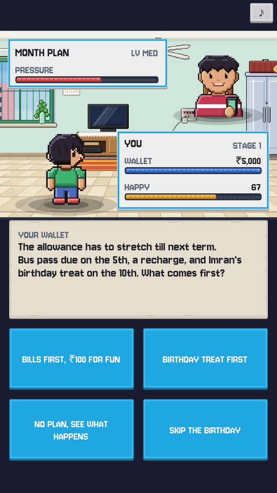
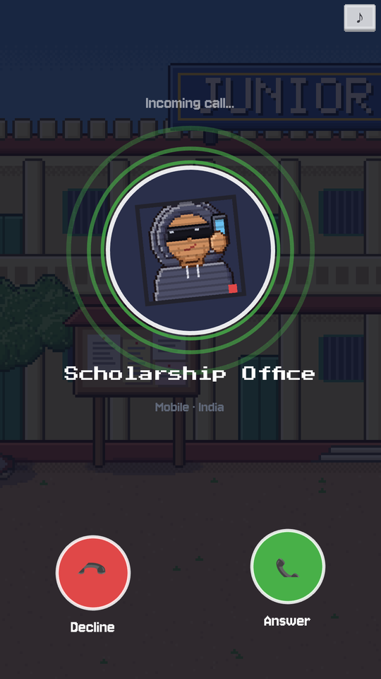
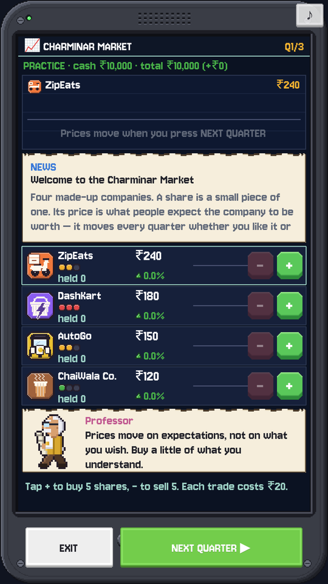
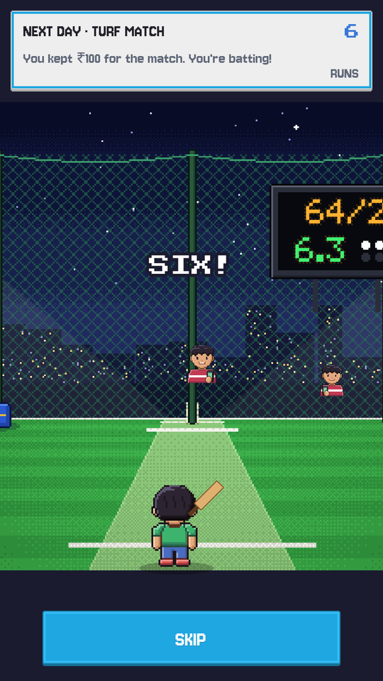
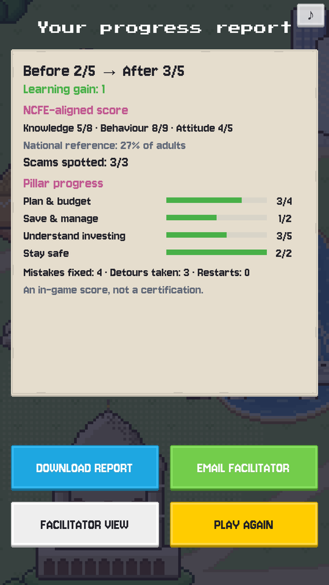
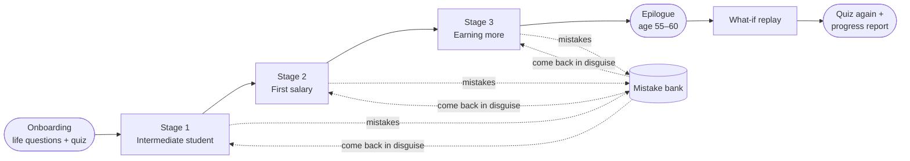

<div align="center">


# ₹ PaisaPath

**Learn money by living it.**<br/>
A pixel-art life-sim where every money decision is a battle — and every mistake comes back for a rematch.

<p>
  <a href="https://paisapath.r17.workers.dev/"></a>
</p>

<p>
  
  
  
  
  
  
  <a href="LICENSE"></a>
</p>

<p>
  <a href="#-screenshots">Screenshots</a> •
  <a href="#-features">Features</a> •
  <a href="#-how-it-plays">How it plays</a> •
  <a href="#-quick-start">Quick start</a> •
  <a href="#️-tech-stack">Tech stack</a> •
  <a href="#-team">Team</a>
</p>

<sub>Built at <b>Megathon X</b> (E-Cell, IIIT Hyderabad) · Team 97 · Problem statement by Vanguard</sub>

</div>

---

## 📸 Screenshots

<div align="center">
<table>
  <tr>
    <td align="center"><br/><sub><b>Money battles</b></sub></td>
    <td align="center"><br/><sub><b>Scam calls</b></sub></td>
    <td align="center"><br/><sub><b>Charminar Market</b></sub></td>
    <td align="center"><br/><sub><b>Turf cricket</b></sub></td>
    <td align="center"><br/><sub><b>Progress report</b></sub></td>
  </tr>
</table>
</div>

## ✨ Features

PaisaPath teaches financial literacy to Grade 11–12 students in Hyderabad. You live a compressed life, from Intermediate student to first salary to earning more, and every money task is a turn-based battle on a living map of the city.

<table>
  <tr>
    <td width="50%" valign="top">
      <h4>⚔️ Money battles</h4>
      Every decision (budgeting, saving, borrowing, investing) plays out as a Pokémon-style battle. The lesson comes <i>after</i> the choice, as a short animation.
    </td>
    <td width="50%" valign="top">
      <h4>🔁 Mistake bank</h4>
      Wrong answers are remembered and come back later in disguise, so a concept is learned rather than guessed.
    </td>
  </tr>
  <tr>
    <td valign="top">
      <h4>📞 Real-feeling scam calls</h4>
      KYC, lottery and scholarship scams ring like a real phone call, and you decide whether to pick up.
    </td>
    <td valign="top">
      <h4>📈 Charminar Market</h4>
      A stock-market minigame with four made-up companies: a practice round first, then your own savings.
    </td>
  </tr>
  <tr>
    <td valign="top">
      <h4>🗣️ Three languages, fully voiced</h4>
      English, Telugu and Hindi, switchable on the title screen, with 400+ voice-over clips.
    </td>
    <td valign="top">
      <h4>🔮 “What if?” replay</h4>
      At the end, your biggest mistake is replayed with the other choice, so you see what it would have changed.
    </td>
  </tr>
  <tr>
    <td valign="top">
      <h4>📄 Facilitator report</h4>
      A PDF progress report with before/after quiz scores, sent to the NGO facilitator (guardian CC'd) or downloaded offline.
    </td>
    <td valign="top">
      <h4>📱 Works offline</h4>
      An installable PWA for phones, tablets and desktops that keeps working with no signal.
    </td>
  </tr>
</table>

### The four pillars

| | Pillar | In the game |
|:-:|---|---|
| 🧾 | **Plan & budget** | Pocket money, first salary, rent and EMIs |
| 🏦 | **Save & manage** | An emergency buffer, impulse buys vs. happiness |
| 🌱 | **Understand investing** | Compounding, SIPs, risk, and the Charminar Market |
| 🛡️ | **Stay financially safe** | Scam calls, UPI fraud, loan apps, and when to say no |

## 🎮 How it plays



Two bars follow you all game: **wallet** and **happiness**. An impulse buy makes you happy now, and being too broke for plans with friends later makes you unhappy.

## 🚀 Quick start

> **Prerequisites:** Node.js 20+ and npm, plus a modern browser (Chrome recommended). The layout adapts to phones, tablets and desktop.

```bash
# 1. Install
npm install
cd server && npm install && cd ..

# 2. Run
npm run dev          # game at http://localhost:5173 (also on your LAN IP, for phones)
npm run server       # optional: report e-mail service at http://localhost:8787
```

<details>
<summary><b>All scripts</b></summary>
<br/>

| Command | What it does |
|---|---|
| `npm run dev` | Start the game with hot reload |
| `npm run build` | Production build → `dist/` (PWA, offline-capable) |
| `npm run preview` | Serve the production build |
| `npm test` | Engine unit tests (Vitest) |
| `npm run validate:content` | Check every task, string and asset reference |
| `npm run check` | Type check + lint + tests + content validation |
| `npm run server` | Report e-mail service (needs `SMTP_*` env vars to send) |

</details>

<details>
<summary><b>Deploying</b></summary>
<br/>

The game is a static site, so any static host works. The live build runs on Cloudflare Workers:

- **Build command:** `npm run build`
- **Deploy command:** `npx wrangler deploy --assets=./dist --name paisapath --compatibility-date 2026-10-01`

Without the report server, the end-of-game report falls back to a PDF download. To e-mail it instead, host `server/` on any Node host and build with `VITE_REPORT_SERVICE_URL` pointing at it.

</details>

## 🛠️ Tech stack

<p>
  
  
  
  
  
  
  
</p>

```
src/
├── engine/      # game rules: wallet, happiness, scoring (unit-tested)
├── game/        # Phaser scenes, UI, music and voice
├── content/     # tasks, explainers and strings in EN / TE / HI, validated with Zod
├── minigames/   # turf cricket and other side games
├── app/         # boot, session, save data, PDF report
└── shared/      # types and i18n
server/          # optional Express service that e-mails the report
public/          # sprites, Hyderabad backdrops, fonts, music, voice-over
```

## 👥 Team

<div align="center">
<table>
  <tr>
    <td align="center"><a href="https://github.com/17ronith"><br/><sub><b>Ronith Menneni</b></sub></a></td>
    <td align="center"><a href="https://github.com/Aakarsh1402"><br/><sub><b>Aakarsh Mishra</b></sub></a></td>
    <td align="center"><a href="https://github.com/monishram2508"><br/><sub><b>Monishram Selvaraj</b></sub></a></td>
    <td align="center"><a href="https://github.com/Saha264"><br/><sub><b>Kallu Saharsh Reddy</b></sub></a></td>
  </tr>
</table>

<sub>Original repository: <a href="https://github.com/IIIT-ECell/megathon26-mars">IIIT-ECell/megathon26-mars</a></sub>
</div>

## 🙏 Credits

<details>
<summary><b>Third-party assets and libraries</b></summary>
<br/>

- [Phaser 3](https://phaser.io/): MIT
- **Client libraries:** [zod](https://zod.dev/) (MIT), [jsPDF](https://github.com/parallax/jsPDF) (MIT), [idb-keyval](https://github.com/jakearchibald/idb-keyval) (Apache-2.0). **Report service:** [Express](https://expressjs.com/) (MIT), [cors](https://github.com/expressjs/cors) (MIT), [Nodemailer](https://nodemailer.com/) (MIT-0). **Tooling:** Vite, vite-plugin-pwa, Vitest, TypeScript, ESLint, Prettier, tsx (MIT / Apache-2.0)
- [Kenney Tiny Town](https://kenney.nl/assets/tiny-town), [RPG Urban Pack](https://kenney.nl/assets/rpg-urban-pack), [Tiny Dungeon](https://kenney.nl/assets/tiny-dungeon) and [Pixel UI Pack](https://kenney.nl/assets/pixel-ui-pack): CC0, under `public/assets/kenney/` with their licence files
- Fonts under `public/assets/fonts/` (Press Start 2P, Jersey 10): SIL Open Font License, licence files alongside
- Voice-over clips (`public/assets/voice/`): generated offline with [Kokoro-82M](https://huggingface.co/hexgrad/Kokoro-82M) (Apache-2.0); see `src/content/voice/README.md`
- Map in the report and slides (`deliverables/src/shots/real_map.jpg`): © [OpenStreetMap](https://www.openstreetmap.org/copyright) contributors (ODbL)
- Hyderabad battle backdrops (`public/assets/backdrops/`) and Charminar Market art (`public/assets/market/`): original pixel art by the team, generated with the scripts in `team97_vanguard_context/08_hyderabad_backgrounds/source/`

</details>

**External resources:** none. All content and assets are in this repository.

## 📜 License

Released under the [MIT License](LICENSE).

<div align="center">
<br/>
<sub>Made with ❤️ and a lot of chai in Hyderabad</sub>
</div>
